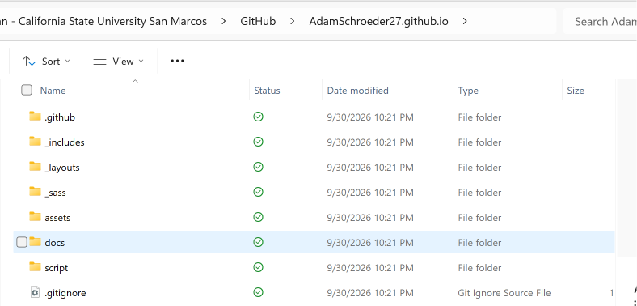
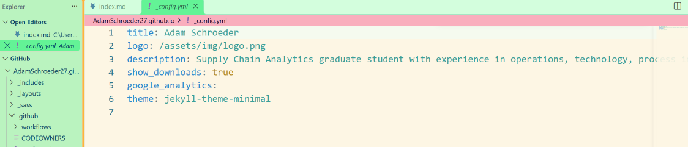
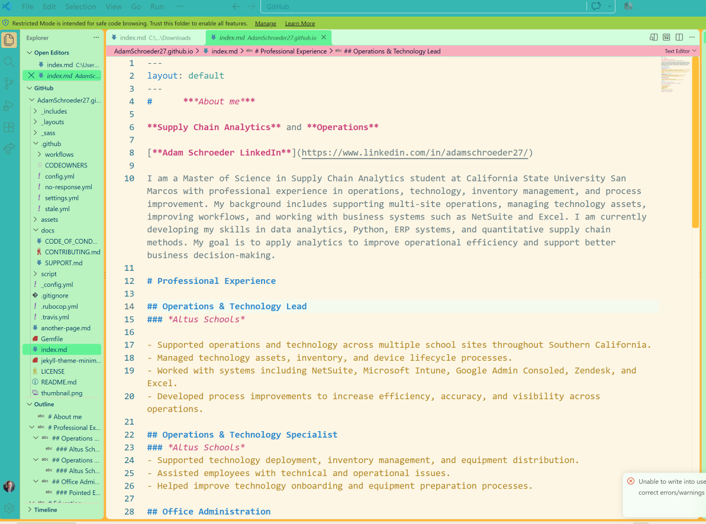
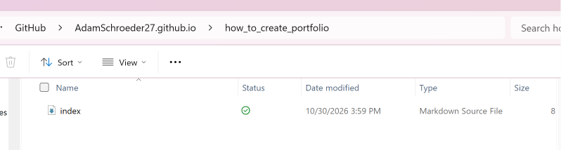

# Outline of how my e-portfolia was built

In order to create a an e-portfolia using my github username I followed the following steps. I used the **Minimal** Jekyll theme provided which helped create the classic resume look. The idea was to put my all of my proffessional experiences and education in one place, that is easily distributable. This will eventually be a hub for class projects in one place.

The theme controls the appearance of the website, in only added my personal information to it. I did nott change the original theme's layout or styling. Most of what I worked on was the configuration file and the Markdown file that holds the homepage.

My [GitHub repository](https://github.com/AdamSchroeder27/AdamSchroeder27.github.io) is called `AdamSchroeder27.github.io`, and my website address is [adamschroeder27.github.io](https://adamschroeder27.github.io/).

## Getting the original website set up

### Creating the repository and adding the theme

The first part of the project was making sure I had a GitHub repository named after my username, followed by `.github.io`. That naming format is what GitHub Pages uses for a personal website.

Once the repository was created, I downloaded the Minimal theme provided in our Milestone I instructions. After downloading and extracting the files, I added them to my local repository. The Minimal theme gave me the basic layout and structure of the website, which let me focus on adding my own information rather than building a website from scratch.

The repository includes folders such as _includes, _layouts, _sass, and assets, which contain files used by the theme. I kept the original theme design and focused primarily on updating the content and configuration files to make the portfolio my own.




### Setting the site information

The theme came with an `_config.yml` file. Instead of editing the website design, I used this file to set the information that appears with the theme. 


The `title` and `description` are specific to my portfolio. The `logo` setting tells the theme where to look for the image, while the `theme` setting identifies the Minimal theme. The class assignment also called for replacing the original `assets/img/logo.png` picture with a headshot, keeping the same filename so the image path would still work.




### Editing the homepage in VS Code

I used Visual Studio Code to edit the root `index.md` file. This is the file that contains the text everyone see when they open the main page of my portfolio.

I started with a an About Me section. I wrote about studying supply chain analytics at CSUSM and about my background in operations and technology. I also included a [LinkedIn link](https://www.linkedin.com/in/adamschroeder27/).

Below that, I wrote about my experience at Altus Schools and Pointed Engineering, then my education at CSUSM and LSU Shreveport. I used a resume-like layout because it made sense for the information I wanted to show.

Markdown was enough to format everything without having to write the page in HTML. For example, this is how part of my experience section is set up:

In order to add in proper formatting, I used basic markdown language. The number of `#` symbols changes the heading level. The asterisks around *Altus Schools* italicize the employer name, and the dashes create a list. I also used bold text and links in other parts of the homepage. Between the heading levels, bold and italic text, lists, and links, I could organize the page the way I wanted using basic Markdown.



### Pushing up the changes and Jupyter Testing

Once the theme and homepage files were in the repository, the last part of Milestone I was committing and pushing the changes to GitHub. The assignment also required checking the **Actions** tab for a successful Pages build and deployment, and then visiting the public website to make sure the changes actually appeared. In addition I created a second Jupyter notebook for a testing enviroment seperate from my main index that provided trial and error without changing my main.

I think it's worth doing both checks. Having the files on GitHub doesn't necessarily tell you how they look on the website. The published page is where I can see whether the headings, photo, and links came through correctly.

## Adding another page for Milestone II

For this milestone, I needed more than the single homepage. The new page is the guide you're reading right now.

### How I organized the files

I made a folder called **how_to_create_portfolio** in the repository and added a new `index.md` inside it. It uses the same layout I used as the homepage. For this I used a more specific title than something like **subpage_1** to help give guidance.

The important part of the folder layout now looks like this:



The homepage's `index.md` is still at the topof the repository. The second `index.md` is inside the new folder. The file is [adamschroeder27.github.io/building-my-eportfolio/](https://adamschroeder27.github.io/building-my-eportfolio/) once it is published.

### Connecting it to the homepage

I went back to the original `index.md` and added a **Projects** section underneath Education. I didn't need to change the theme's navigation. I just added a Markdown link to the folder:

```markdown
# Projects

## How I Built My E-Portfolio

[My e-portfolio setup guide](building-my-eportfolio/)
```

That link uses a relative path. Since the folder has its own `index.md`, clicking the link opens the guide instead of a file download.

## Checking the finished result

Before turning in the second milestone, I need to commit and push the new files, wait for GitHub Pages to publish them, and open the site myself. Specifically, I want to make sure the Projects link works, the new page uses the same Minimal layout, the image paths work, and the link back to the homepage goes where it should. VS Code also has a [Markdown preview](https://code.visualstudio.com/docs/languages/markdown#_markdown-preview), which is good for checking the formatting while editing.

OOOOOOOOOO


The main thing I learned from this assignment is how the files are connected: `_config.yml` holds the site settings, the root `index.md` is the homepage, and putting another `index.md` in a folder creates another page. I can use the same setup later to add actual analytics projects instead of trying to fit everything onto the homepage.

## References

- Karimi, M. (2026). *Milestone I assignment instructions* Used for main guidence on intruction
- [GitHub Pages documentation — Creating a GitHub Pages site](https://docs.github.com/en/pages/getting-started-with-github-pages/creating-a-github-pages-site).
- [Visual Studio Code — Markdown editing](https://code.visualstudio.com/docs/languages/markdown). Reference for Markdown preview.
- OpenAI. (2026). *ChatGPT* [Large language model]. https://chatgpt.com/. Guided on markdown language required for folder layout and inserting images.
